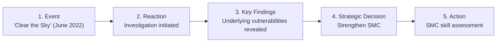
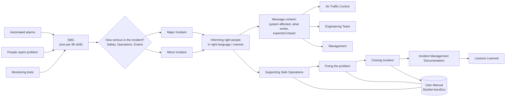

> **Background only.** This file describes the original SkyNet engagement (assessment, platform concept). That phase is complete. It explains *who* SkyNet and the SMC are; it does **not** define this project's scope. For scope, use `01-project-context.md` and `02-requirements-v01.md`.

# Graduate Academy – Master Wave 2 (Graduate View): Project SkyNet Client Case

> Converted from `Graduate_Academy_Master_Wave_2_Graduate_View (1).pptx` (15 slides, Accenture, © 2026).
> Visual elements (timelines, process flows, matrices, calendars, screenshots) have been interpreted and rebuilt as tables, Mermaid diagrams, or descriptions. Purely decorative photos and icons are described briefly in italics.

---

## Slide 1: Client Case

*Title slide. Photo of an airport apron with Swiss-style red-and-white-cross tail fins, a parked widebody aircraft at a jet bridge, and a traffic cone in the foreground.*

---

## Slide 2: About SkyNet – Ensuring Safe & Efficient Airspace Operations

*SkyNet logo: "SKYNET – Swiss Air Traffic Control".*

**Mission:** "Guiding aviation safely and efficiently through national airspace – 24/7."

### Business areas (four tiles)

| Area | Description |
|---|---|
| **Air Traffic Control (ATC)** | Providing precise aircraft guidance to ensure safe takeoffs, landings, and en-route separation. |
| **Airspace Management** | Optimizing airspace utilization to maximize efficiency and minimize environmental impact. |
| **Air Navigation Services** | Delivering critical navigation and communication infrastructure to pilots and airlines. |
| **Operational & System Resilience** | Ensuring uninterrupted availability of mission-critical IT and operational systems. |

### Key figures (side panel)

| Metric | Value |
|---|---|
| Total employees | 1,500+ |
| Managed flights | 1.2 Mio.+ |
| Controlled airspace | 185,000 km² |
| Operational IT applications | ~125 |
| Mission-critical systems | ~50 |

> Behind every safe flight is a complex ecosystem of systems and specialists. While air traffic controllers guide aircraft, the System Monitoring Control (SMC) division ensures that the systems they rely on never fail.

---

## Slide 3: The Operational Ecosystem – Who Keeps Air Traffic Running?

Behind every instruction given by an ATCO stands a complex IT ecosystem — safeguarded by the SMC function.

The slide contrasts two roles side by side:

| | **Air Traffic Controllers (ATCOs)** | **System Monitoring Controllers (SMCs)** |
|---|---|---|
| Tagline | *The visible frontline of airspace safety* | *The hidden backbone of operational resilience* |
| Responsibilities | Manage aircraft movements in real time; ensure safe separation and sequencing; coordinate takeoffs, landings, and en-route traffic; depend on fully functional IT systems | Monitor ~125 operational IT applications; ensure availability of ~50 mission-critical systems; detect and resolve incidents under time pressure; restore services to avoid operational disruption |
| Key takeaway | → If systems slow down, controllers feel it immediately. | → If systems fail, SMCs act before air traffic is affected. |

*Photo: two controllers in an operations room, one pointing at a radar/flight-data screen while the other, wearing a headset, works at the console.*

---

## Slide 4: Business Context – Why This Case Exists

This engagement is part of SkyNet's long-term effort to enhance systemic resilience — not just incident response.

The slide is a **left-to-right timeline** with five stages leading to this engagement:

| # | Stage | Headline | Details |
|---|---|---|---|
| 1 | **Event** | Critical "Clear the Sky" procedure activated (June 2022) | Major technical disruption resulting in temporary closure of national airspace for several hours. Systems were restored, safety was maintained, operations resumed. |
| 2 | **Reaction** | Investigation initiated | SkyNet leadership launched a structured review to assess structural vulnerabilities across the ecosystem: comprehensive incident review, root cause analysis, cross-functional operational assessment. |
| 3 | **Key Findings** | Underlying vulnerabilities revealed | Resilience depends not only on system recovery, but on how operational and technical roles interact under pressure. Structural improvement potential identified in supporting functions. |
| 4 | **Strategic Decision** | Strategic focus on strengthening SMC | As part of the post-incident measures, SkyNet decided to strengthen the System Monitoring & Control (SMC) function as a critical enabler of operational resilience. |
| 5 | **Action** | SMC skill assessment conducted & improvement areas identified | In a first phase, SkyNet together with Accenture conducted a structured skill assessment within the SMC function. It identified three critical findings requiring immediate attention: (1) Tooling & Knowledge Mgmt., (2) Incident Management Process, (3) Workforce Structure. |

---

## Slide 5: The Role of the System Management Control (SMC)

The SMC function acts as the technical backbone of operational air traffic control.

*Left panel: photo of an engineer at a computer, captioned "System Monitoring Control (SMC) – Ensure continuous availability of operational IT systems supporting air traffic control."*

| Aspect | Description |
|---|---|
| **Operational Backbone** | Ensure continuous availability of ~120 operational IT applications, including ~50 mission-critical systems supporting air traffic control. |
| **Incident Responsibility** | Detect, analyze, and resolve technical incidents under time pressure to prevent operational disruption in 24/7 shift-based operations. |
| **System Interface** | Act as the critical link between operational IT systems and air traffic controllers (ATCOs), ensuring that technical stability enables safe decision-making. |
| **Operational Impact** | SMC performance directly influences recovery speed, incident response quality, operational continuity, and airspace availability. |
| **Required Capabilities** | Strong system understanding across complex environments, structured problem-solving under pressure, high situational awareness, and clear communication across operational and technical teams. |

*Note: this slide says ~120 applications; slides 2, 3 say ~125.*

---

## Slide 6: SMC Assessment – Detailed Findings Across Three Critical Areas

The slide is a **3 × 3 matrix**: three critical areas (columns) × Today / Key Findings / Impact (rows).

### Today (current state)

| Tooling & Knowledge Management | Incident Management Process | Workforce Structure |
|---|---|---|
| The current tool landscape does not support fast, structured decision-making in time-critical situations. | Incident handling follows general principles but lacks structured tool-supported guidance during critical situations. | Long-term SMC workforce dynamics pose structural risks to scalability, knowledge continuity and long-term operational resilience. |

### Key findings

**Tooling & Knowledge Management**
1. Static PDF-based user manuals
2. No incident-oriented structuring ("What to do now?")
3. No prioritization of critical content
4. No cross-linking between related information
5. No change transparency or update notification mechanism
6. Manual document updates & version tracking
7. High reliance on individual experience

**Incident Management Process**
1. Semi-defined documentation templates
2. No enforced documentation standards or quality criteria
3. No automated escalation or assignment control
4. Incidents can be incorrectly assigned or not actively managed
5. Manual stakeholder communication (SMS / email)
6. Parallel handling of stabilization, communication, and documentation

**Workforce Structure**
1. Ageing SMC population (avg. ~53 years)
2. Limited inflow of younger talent
3. ~1 year onboarding period
4. Strong knowledge concentration in senior staff
5. Language barrier in English incident documentation due to two different locations in Geneva and Zurich (mother tongues DE or FR)
6. Security risk due to use of external translation tools

### Impact

| Tooling & Knowledge Management | Incident Management Process | Workforce Structure |
|---|---|---|
| Delayed access to critical information; increased cognitive load during incidents; risk of acting on outdated knowledge | Increased variability in incident handling; reduced consistency across shifts; documentation quality strongly dependent on the experience of individual SMCs | Knowledge continuity risk; high onboarding effort; potential compliance exposure |

> **Conclusion:** The SMC division shows improvement potential across multiple structural dimensions, providing a clear roadmap for strengthening operational resilience step by step.

---

## Slide 7: 4-Week Engagement – Scope & Objectives

The slide reads left to right: **Overall Objective → Focus Areas → In Scope → Innovation Dimension → Deliverables / Out of Scope**.

### Overall objective

Design a digital, unified and intelligent **SMC Support Platform** replacing:
- Static user manuals
- Incident documentation setup

The future solution shall reduce cognitive load, simplify workflows, and strengthen resilience in critical situations.

### Focus areas and what is in scope

| Focus area | In scope | Key ambition |
|---|---|---|
| **Tooling & Knowledge Management** | Re-design the current user manual landscape into: a digital knowledge platform (replacing static PDFs); an incident-oriented guidance approach ("What do I need now?"); a traceable framework (version transparency & change tracking); a reusable knowledge base to support onboarding & knowledge distribution | From static documentation → to dynamic operational guidance |
| **Incident Management Process** | Re-design incident handling & documentation workflow to: provide a structured incident workflow; automate escalation & assignment; integrate stakeholder communication; improve documentation quality & consistency; simplify post-incident reporting | From manual parallel handling → to guided, tool-supported workflow |

*(Workforce Structure, the third finding area from slide 6, is not a focus area here.)*

### Innovation dimension (applies to both focus areas)

The solution should explore:
- AI-supported incident guidance
- Intelligent search & summarization
- Secure multilingual support
- Automation & decision support
- Decision-support logic in time-critical situations
- Knowledge extraction from historical incidents

The goal is not incremental improvement, but a forward-looking and resilient design.

### Deliverables after 4 weeks

Each team will deliver:
1. Clickable prototype of an improved User Manual solution
2. Structured concept for incident support
3. Training & rollout concept for implementation

### Out of scope

1. Full technical implementation
2. Organizational restructuring of the SMC workforce
3. Replacement of underlying IT systems
4. Budget & procurement planning

> **Expected Outcome:** A unified SMC Support Platform combining knowledge, incident handling, automation and AI — designed to reduce cognitive load and strengthen resilience.

---

## Slide 8: What Happens When Systems Fail – The SMC Perspective

A **7-step swimlane process diagram** with three rows: *Steps* (descriptions), *Activities* (an icon flow), and *Issues* (today's pain points).

### Activity flow

Reading the diagram: three detection channels feed into the single SMC on shift, who triages the incident as major or minor. Both paths lead to stakeholder communication (ATC, Engineering, Management), then stabilization, fixing, and closing. Steps 4–6 all rely on the AeroDoc user manuals. The flow ends with documentation and lessons learned.

### Step-by-step detail

| Step | What the SMC does | Activities shown | Issues today |
|---|---|---|---|
| **1. Detect** | Identifies a technical anomaly via monitoring tools, automated alarms, or reports from air traffic operations. From this moment on, the SMC is responsible for understanding and managing the situation. | Automated alarms, people reporting a problem, monitoring tools → SMC (one per 8h shift) | — |
| **2. Assess Severity** | Evaluates the safety impact, operational constraints, and overall extent of the issue; classifies the incident as minor or major. | Decision: "How serious is the incident?" (Safety, Operations, Extent) → Major / Minor Incident | ⚠️ Assessment heavily reliant on experience |
| **3. Inform Stakeholders** | Informs relevant stakeholders about the affected system, status, and expected impact. Communication must be clear, timely, and adapted to different audiences and languages. | Informing the right people in the right language / manner; message covers system affected, what works, expected impact; recipients: Air Traffic Control, Engineering Team, Management | ⚠️ Manual SMS process, not structured · ⚠️ Language barrier (DE / FR / EN) |
| **4. Stabilize Operations** | Ensures safe operations can continue, e.g. by activating fallback systems. Goal: provide technical transparency so operational decisions can be made safely. | Supporting safe operations (uses AeroDoc user manual) | ⚠️ No structured "What do I need now?" view |
| **5. Diagnose, Coordinate Fix** | Analyzes the root cause, consults user manuals, and coordinates technical teams or suppliers to resolve the issue, while continuously monitoring system stability. | Fixing the problem (uses AeroDoc user manual) | ⚠️ Knowledge scattered across static documents |
| **6. Restore & Verify** | Once resolved, verifies that the system is stable and safe for operational use. Stakeholders are informed before returning to normal operations. | Closing incident (feeds into AeroDoc) | — |
| **7. Document & Learn** | Documents the incident, actions taken, and outcomes in the incident management tool. Lessons learned are shared internally. | Incident management documentation → Lessons learned | ⚠️ Inconsistent documentation quality · ⚠️ No structured knowledge reuse |

---

## Slide 9: SMC Tooling Landscape – As-Is Environment

A layered table of the four tool layers, colour-coded from dark to light purple.

| Layer | Purpose | Application / layer scope | Pain points |
|---|---|---|---|
| **Monitoring & Detection Layer** | Monitoring Tools & Alarms | ~120 applications monitored; ~50 mission-critical systems; alerts via monitoring tools / phone / people | Multiple entry channels; no structured triage guidance |
| **Knowledge Layer – Document Management Tool (AeroDoc)** | User manuals per application | Static PDFs; no incident-oriented structuring; manual search (scroll + keyword search); no cross-linking; no update notification mechanism | Information scattered across documents; no "What do I need now?" view; high reliance on individual experience; version awareness manual |
| **Incident Documentation Layer – ServiceNow** | Incident Management Tool | Semi-defined template; no enforced documentation standards; manual escalation & assignment control; English-only documentation; no built-in multilingual support | Inconsistent documentation quality; language barrier (DE / FR → EN); external translation tools used (security risk); incidents difficult to reuse systematically |
| **Communication Layer (Parallel, Manual)** | Stakeholder Communication | SMS procedure for management; manual email updates; no integrated communication logic; no structured escalation workflow | Highly manual; cognitive overload in critical situations; availability dependency (24/7 SMS procedure) |

> Today's landscape consists of separate tools for monitoring, documentation, and communication – loosely connected and heavily dependent on individual experience.

---

## Slide 10: Case Mission – Designing the Future SMC Support Platform

*Turning knowledge and incident handling into a unified, intelligent support experience.*

### Engagement facts (side panel)

| | |
|---|---|
| **Client** | National Air Traffic Service Provider |
| **Advisor** | Accenture |
| **Project duration** | 4-week engagement |
| **Team setup** | 3 cross-functional teams; 6–7 graduates per team; mix of business, tech, UX & AI perspectives; close exchange with SMC stakeholders |

*SkyNet and Accenture logos.*

### Overall objective

Design a **digital, unified and intelligent SMC Support Platform** that:
- Replaces static user manuals and fragmented incident documentation
- Simplifies incident handling under pressure
- Reduces cognitive load
- Strengthens operational resilience

### Mission focus

Each team designs a **future-ready solution concept** covering:
- Knowledge & user manual replacement
- Incident management & documentation
- Intelligent support (AI, automation, multilingual capability)

### Expected deliverables

Each team delivers:
1. **Clickable prototype:** demonstrating the future SMC platform (knowledge access + incident handling + documentation flow)
2. **Structured solution concept:** including architecture, process logic & AI integration approach
3. **Implementation & rollout concept**
   - Training & onboarding approach
   - Change & adoption considerations
   - Phased implementation logic

---

## Slide 11: Core Question

> ***How might we design an intelligent / AI-powered SMC Support Platform that transforms knowledge into real-time guidance and simplifies incident handling under pressure?***

Three supporting questions:
1. How do we deliver real-time, situation-based guidance ("What do I need now?")?
2. How can incident documentation become structured, automated, and secure?
3. How can knowledge be systematically captured, reused, and improved?

**Speaker notes (alternative framings):**
- How might we design a unified, digital SMC Support Platform that provides real-time, incident-oriented guidance, reduces cognitive load under pressure, and strengthens operational resilience?
- How can we transform static documentation and fragmented incident handling into an intelligent, guided, and automated SMC support experience?
- How can AI-enabled knowledge management and structured workflows fundamentally improve how SMCs act in time-critical situations?

---

## Slide 12: AeroDoc – SkyNet Document Management System

**User Manual Storage**

*Screenshot: AeroDoc login page ("SKYNET – Air Navigation Services", "Sign in to AeroDoc – Document Management System v3.8.2") with username/password fields, a Sign In button, and a note that sessions expire after 30 minutes of inactivity. Footer: access requests via IT Service Desk (ext. 4200).*

| Capability | Description |
|---|---|
| **Centralized Documentation Hub** | Platform for storing and accessing operational system documentation |
| **Lifecycle & Version Control** | Supports document upload, updates, approval workflows, and versioning |
| **Structured Technical Access** | Enables organized access to manuals across SkyNet's core operational systems |

---

## Slide 13: AeroDoc – Access Instructions

*Two overlapping browser screenshots: the AeroDoc login page and the AeroDoc "browse" view.*

**What the browse view shows:** a top nav with tabs *Documents, Upload, Reports, Admin, Settings*; a left-hand **Document Library** tree listing SkyNet's core systems with document counts; and a document table for the selected system.

| System (library folder) | # docs |
|---|---|
| SKYFORGE (expanded → Manuals) | 5 |
| HORIZONSYNC | 4 |
| ECHOVOX | 3 |
| AEROSTREAM | 3 |
| SENTINELWATCH | 4 |
| METEOFLOW | 3 |
| GLIDEPATH | 3 |
| TERRAVIGIL | 3 |

SKYFORGE manuals shown:

| Document No. | Title | Size | Modified |
|---|---|---|---|
| SF-OSM-2024-001 | SKYFORGE Operation, Support & Maintenance Manual | 4.8 MB | 2024-06-10 |
| SF-OSM-2024-001 | SKYFORGE Operation, Support & Maintenance Manual | 4.6 MB | 2024-02-15 |
| SF-PM-2024-002 | SKYFORGE Preventive Maintenance Manual | 3.2 MB | 2024-05-07 |
| SF-CM-2024-003 | SKYFORGE Corrective Maintenance Manual | 3.9 MB | 2024-06-28 |
| SF-CM-2024-003 | SKYFORGE Corrective Maintenance Manual | 3.7 MB | 2024-03-10 |

*Observation: duplicate document numbers with different dates/sizes illustrate the "manual version awareness" pain point from slide 9 — older and newer versions sit side by side with no clear indication of which is current.*

### Access instructions

*Removed from this copy. The slide gave a link and shared login for the AeroDoc mock-up, which is not part of this project. Ask the Graduate Academy team for access if you need it.*

---

## Slide 14: Client Input Repository

*Screenshot: Microsoft Teams channel "Graduate Academy – Student Portal → General", Shared tab, path Dokumente › General › 01 Graduate Academy (W1-4), containing folders **Sprint 0 – Enablement, Sprint 1 – Design, Sprint 2 – Build, Sprint 3 – Test**, plus the file "Graduate Academy Master_Graduates view.pptx".*

SkyNet has provided a set of key input materials to support your project work throughout the engagement. In the dedicated Teams channel you will find artefacts such as:
- Organizational structure
- Stakeholder & role descriptions
- Process documentation
- Tooling overview & current setup

These materials are intended to help you understand how SkyNet operates today and serve as the foundation for your solution design.

Use this input to:
- Build a shared understanding of the client context
- Identify pain points and improvement areas
- Ground your target solution in real client conditions

Access the full input repository via the [Teams Channel](https://ts.accenture.com/:f:/r/sites/GraduateAcademyFall2026-GraduatePortal/Shared%20Documents/General?d=wd71314f4980c4dc09f3b63e377ea052f&csf=1&web=1&e=4W4eii).

---

## Slide 15: Project SkyNet Timeline

*A four-week end-to-end project simulation – from onboarding to validated solution.*

**Overarching goal:** Build real consulting readiness through immersive client simulation that mirrors real project work and strengthens the ability to navigate stakeholder dynamics, manage ambiguity, and deliver value.

The slide is a calendar of **20 working days in 4 sprints** (one sprint per week), with rows for Meetings, SME sessions, Phase Goal, and Deliverables.

### Sprints

| Sprint | Days | Week (dates) | Phase goal | Deliverables |
|---|---|---|---|---|
| **Sprint 0 – Enablement** | 01–05 | Week 1: 05.10.–09.10. | **Orientation & Setup** – Teams onboard into the project context, align on scope, roles, and ways of working, and establish the foundation for structured collaboration and delivery. | Project scope; Team – ways of working; Statement of Work (SoW) |
| **Sprint 1 – Design** | 06–10 | Week 2: 12.10.–16.10. | **From Problem to Solution Concept** – Requirements are translated into a structured solution concept. User journeys and initial wireframes define the direction and overall solution approach. | Requirements; High-level solution design; User journeys & wireframes |
| **Sprint 2 – Build** | 11–15 | Week 3: 19.10.–23.10. | **Prototype & Iteration** – The solution takes shape through a functional prototype. Feedback is continuously incorporated to refine usability, structure, and scope. | Clickable prototype; Feedback & prioritized improvements |
| **Sprint 3 – Test** | 16–20 | Week 4: 26.10.–30.10. | **Validation & Closure** – The solution is validated with stakeholders, feedback is consolidated, and outcomes are prepared for final presentation and next steps. | Test strategy & test cases; Validated solution; SteerCo presentation |

SME sessions run throughout each of the four sprints.

### Meeting calendar (decoded from the icon markers)

| Day | Week | Meeting | Type (legend) |
|---|---|---|---|
| 02 | 1 | SMC Lead Interview | SMC Interaction |
| 03 | 1 | Project Kick-off | Project Kick-off |
| 05 | 1 | Sprint Planning | Sprint Planning |
| 06 | 2 | SMC User Interview | SMC Interaction |
| 08 | 2 | Backlog Refinement | Backlog Refinement |
| 09 | 2 | Sprint Review / Retro | Sprint Review / Retro |
| 10 | 2 | Sprint Planning | Sprint Planning |
| 14 | 3 | SMC User Demo | SMC Interaction |
| 14 | 3 | Sprint Review / Retro | Sprint Review / Retro |
| 15 | 3 | Sprint Planning | Sprint Planning |
| 17 | 4 | User Testing | SMC Interaction |
| 17 | 4 | SteerCo Dry Run | SteerCo Presentation |
| 20 | 4 | SteerCo Presentation | SteerCo Presentation |

**Legend:** Sprint Planning · Backlog Refinement · Sprint Review / Retro · Project Kick-off · SteerCo Presentation · SMC Interaction

**Pattern:** each sprint closes with Sprint Planning for the next one (days 05, 10, 15); there is one client (SMC) touchpoint per week — lead interview, user interview, user demo, user testing — and the engagement ends with a SteerCo dry run on day 17 and the final SteerCo presentation on day 20.
